# L0 - System Overview

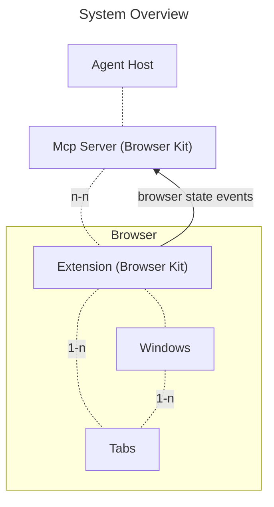

# L1 - Server Core

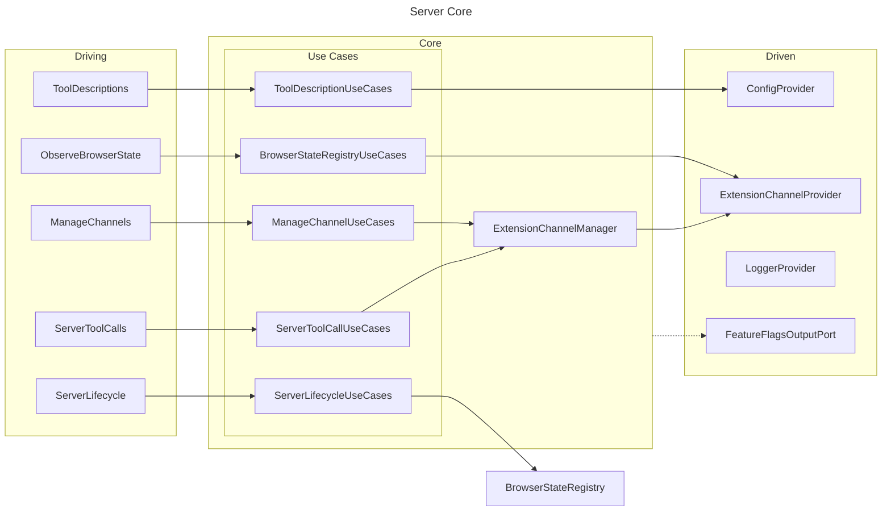

# L1 - Server

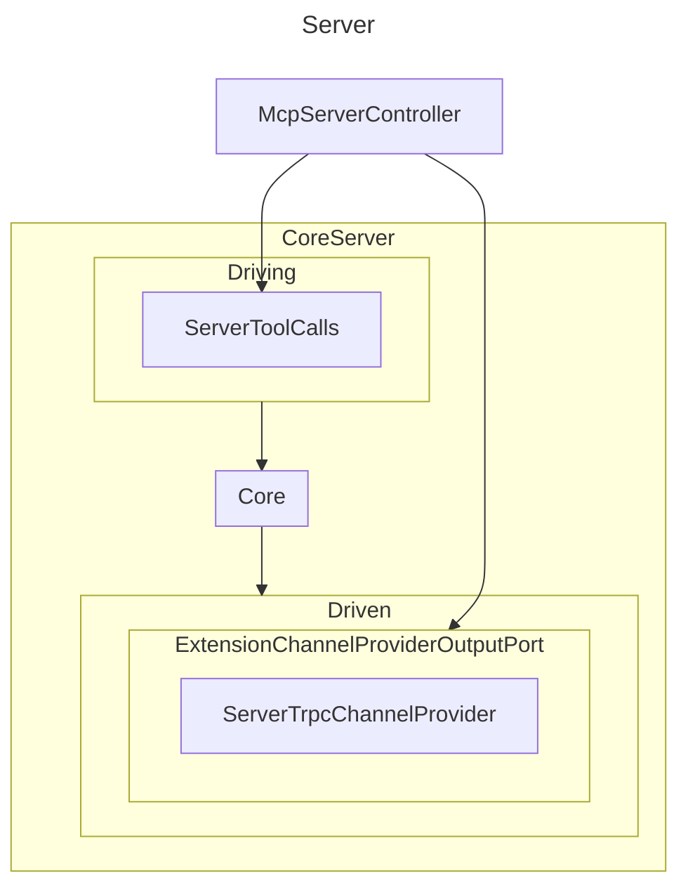

# L1 - Extension Core

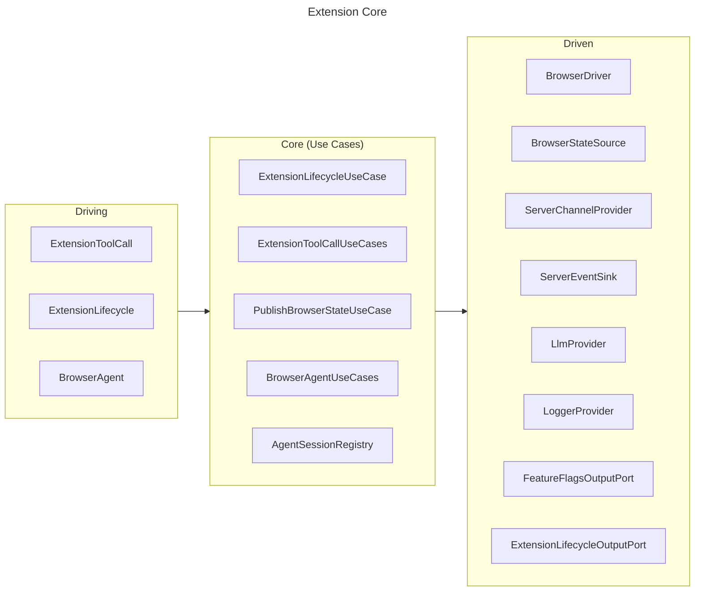

## L2 - Extension Tool Calls

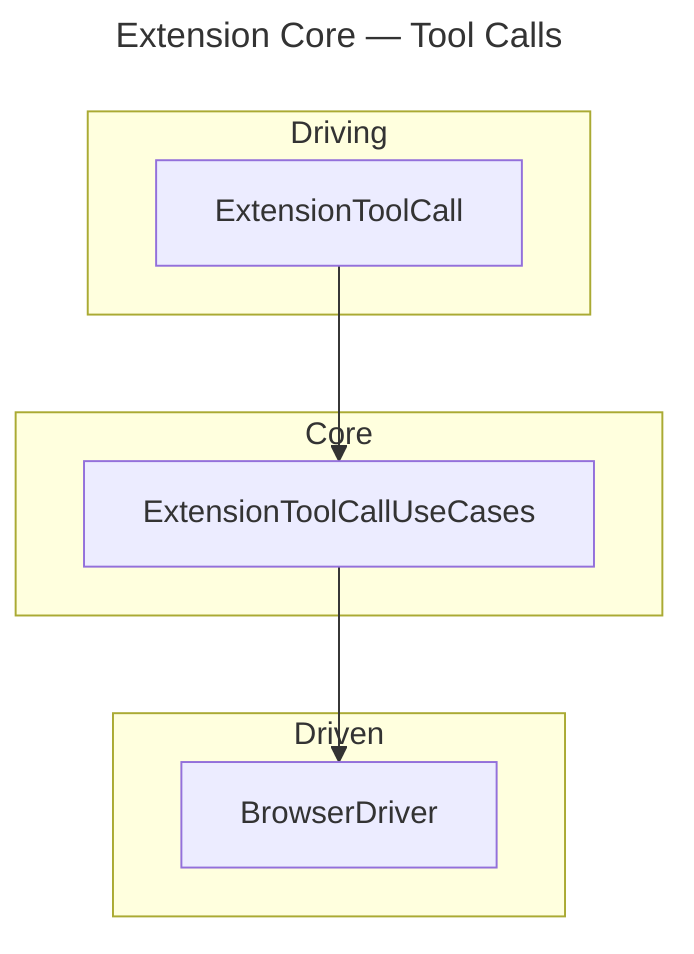

## L2 - Browser-State Publishing

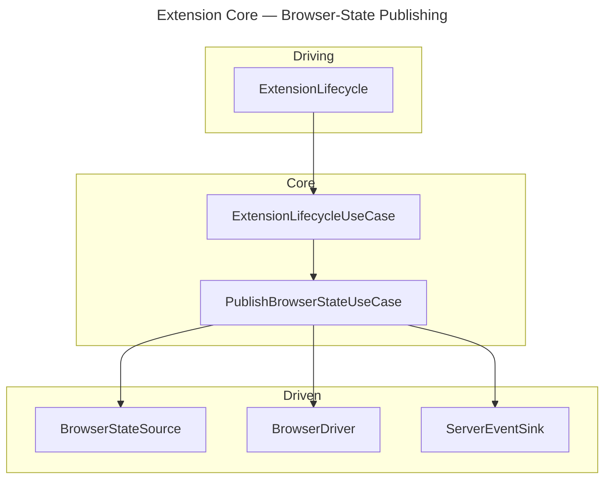

## L2 - Browser Agent

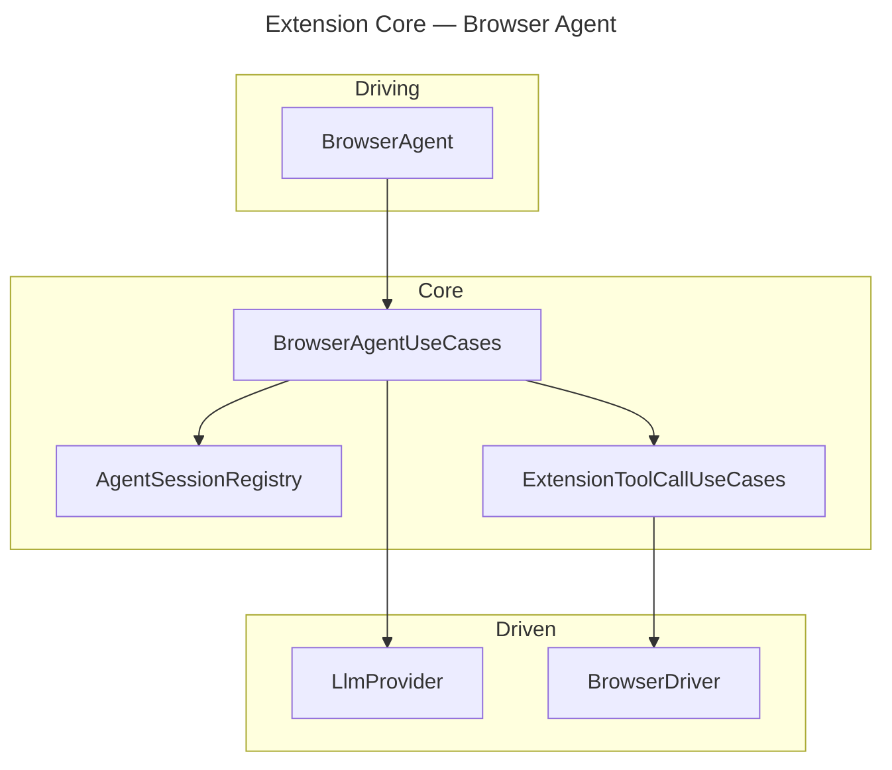

# L1 - Extension Architecture

All components grouped by runtime (the deployment "layers"); the channel sub-diagrams below detail
each cross-runtime link. `CoreExtension` internals are in
[Extension Core Architecture](#extension-core-architecture-level-0).

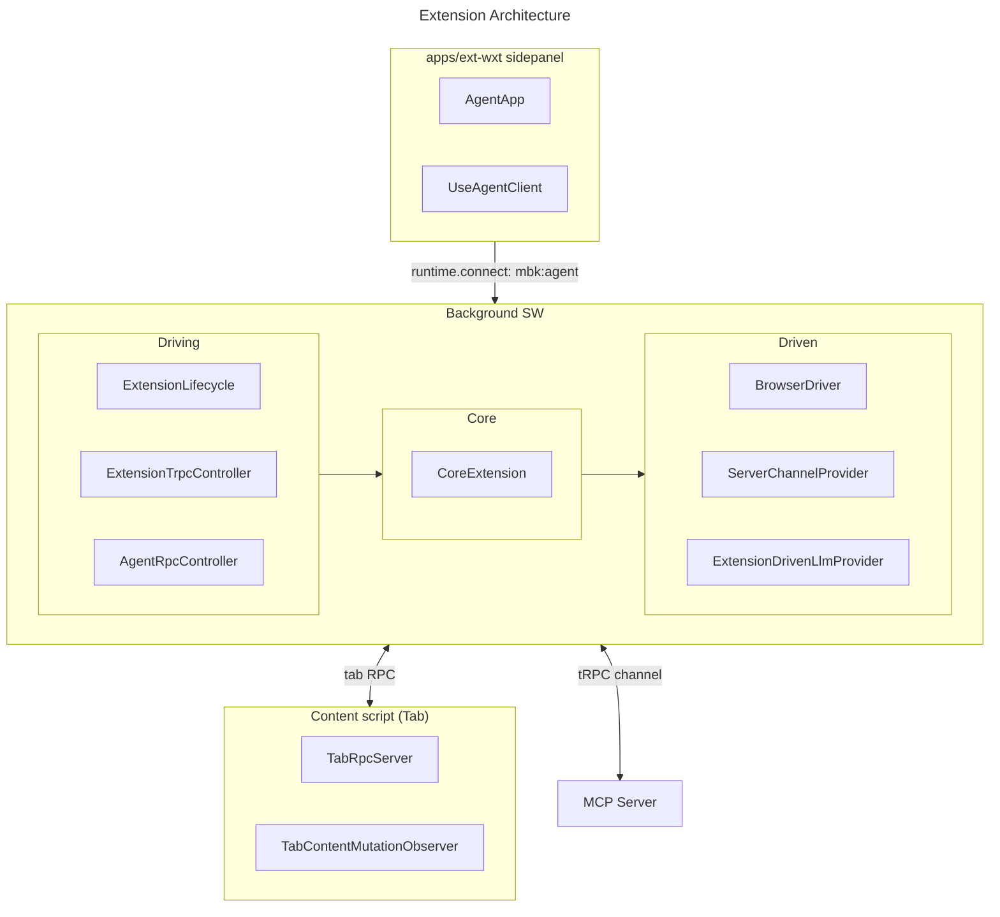

## L2 - Channel — Background ⇄ Tab

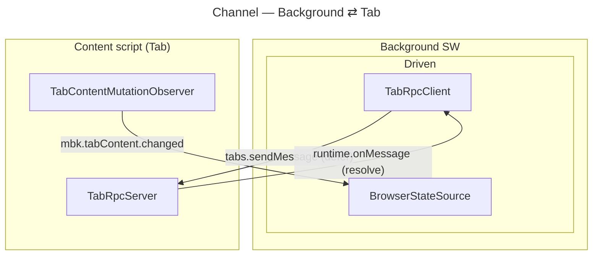

## L2 - Channel — Background ⇄ MCP Server

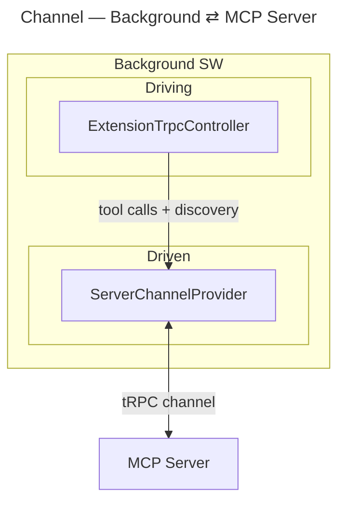

## L2 - Browser Agent Architecture

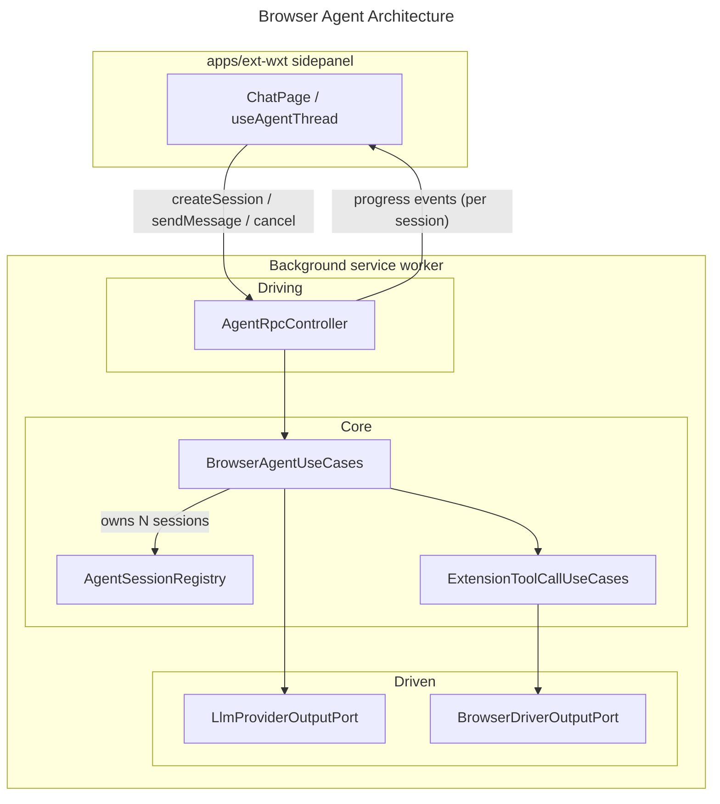

`AgentRpcController` is `@mcp-browser-kit/extension-driving-agent-rpc`. The
sidepanel and the background are separate documents, so it bridges them over a
single `browser.runtime` port named `mbk:agent`, multiplexed by frame key: RPC
`defer`/`resolve` frames for the imperative calls, pushed `agentEvent` frames for
the progress stream (`subscribe` takes a callback and cannot cross a port).

Two MV3 constraints shape it. Each connected UI gets its own transport and its
own agent subscription, torn down on disconnect, because the sidepanel is opened
and closed constantly. And because an idle service worker is evicted after ~30s
— taking the in-memory session registry with it — reconnection is lazy rather
than eager (reconnecting on disconnect would simply revive the worker) and
signals `onReconnect` so the UI re-hydrates from `listSessions`/`getHistory`
instead of trusting its cache.

`LlmProviderOutputPort` is realized by
`@mcp-browser-kit/extension-driven-llm-provider`, a registry over per-vendor
strategies. The port speaks in flat ids; the registry treats them as composite
`"<providerId>:<modelId>"`, because model ids are only unique within a vendor.
Two strategies ship:

- **OpenRouter** — one API key, many models, via `@ai-sdk/openai-compatible`.
- **GitHub Copilot** — gated behind the `copilot-provider` feature flag, which
  defaults to **off**. GitHub publishes no third-party API for Copilot
  subscriptions, so this signs in as an editor would; that is contrary to the
  Copilot terms of service. The impersonation details are confined to
  `providers/copilot/constants.ts`.