# L0 - System Overview

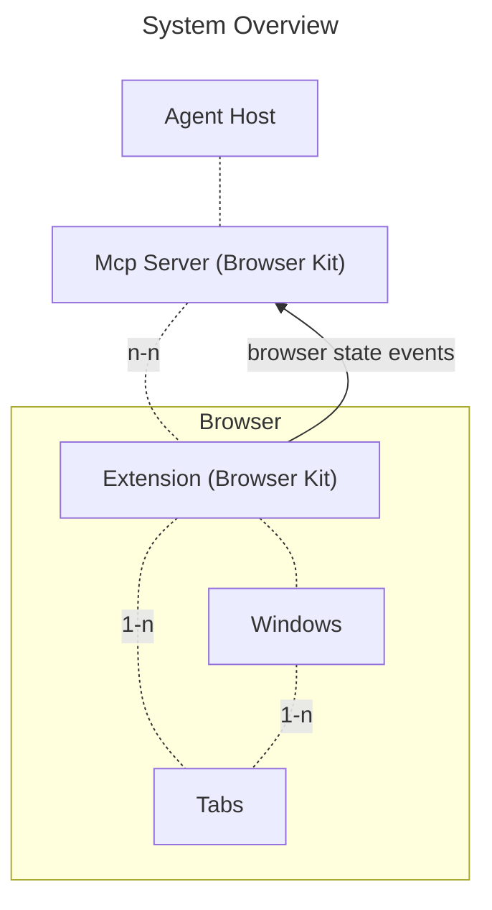

# L1 - Server Core

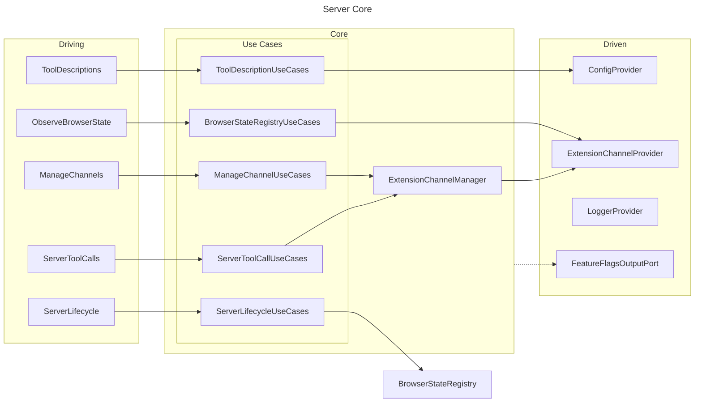

# L1 - Server

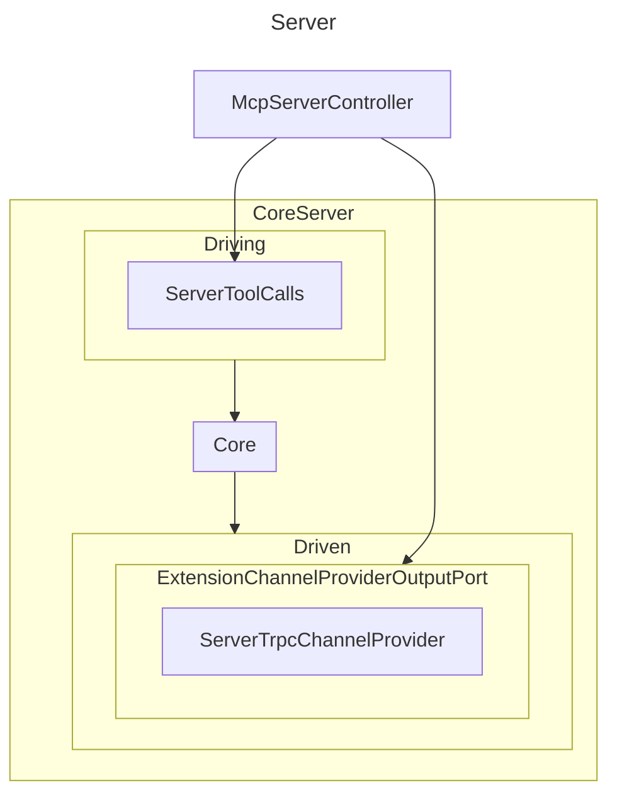

# L1 - Extension Core

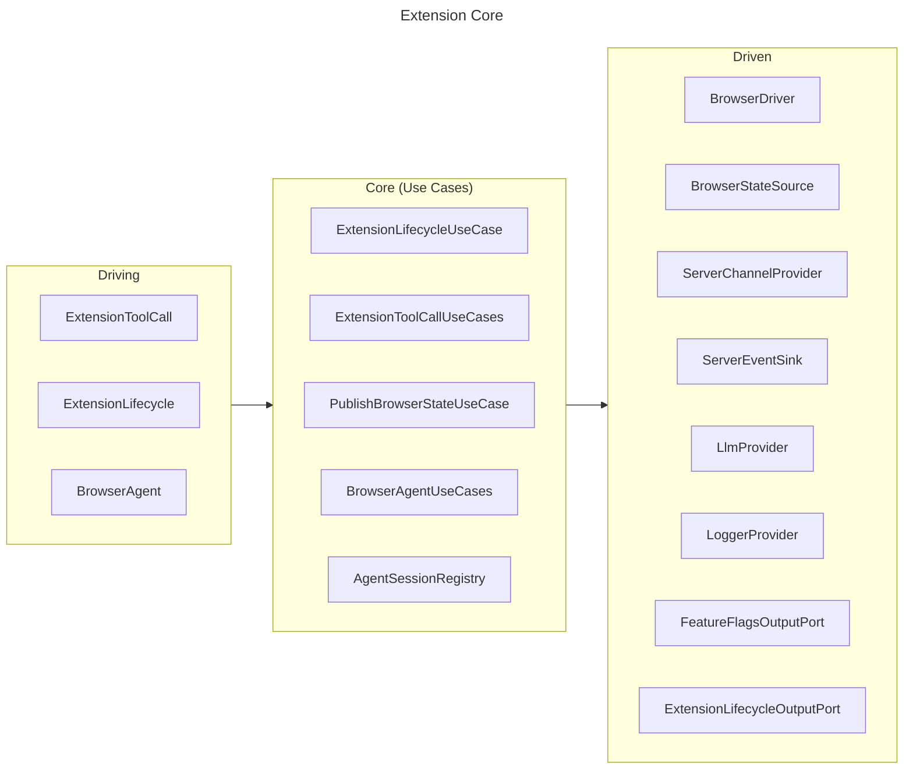

## L2 - Extension Tool Calls

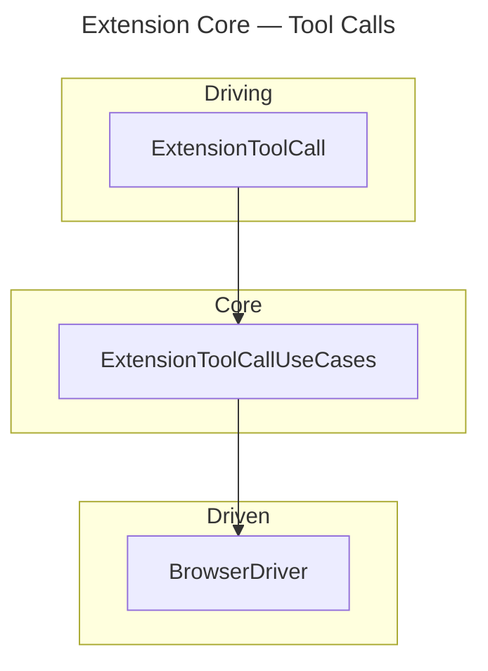

## L2 - Browser-State Publishing

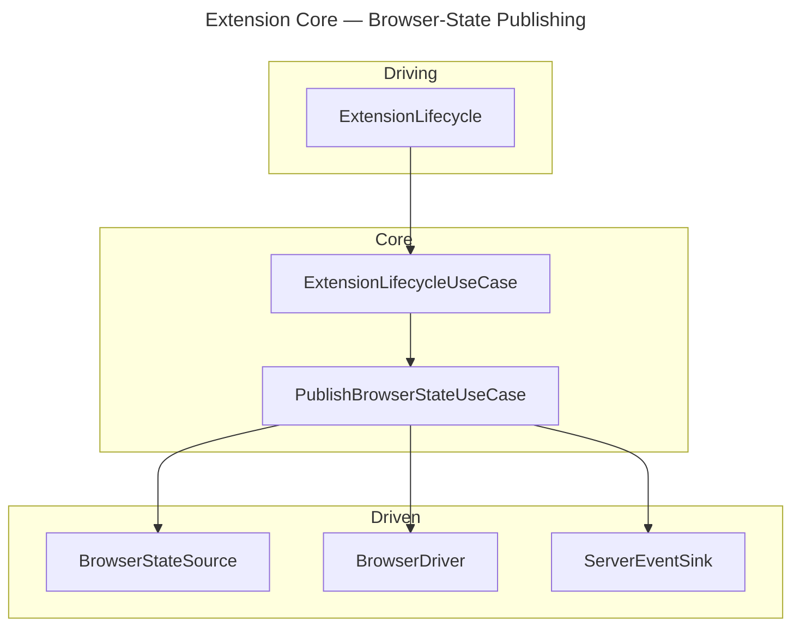

## L2 - Browser Agent

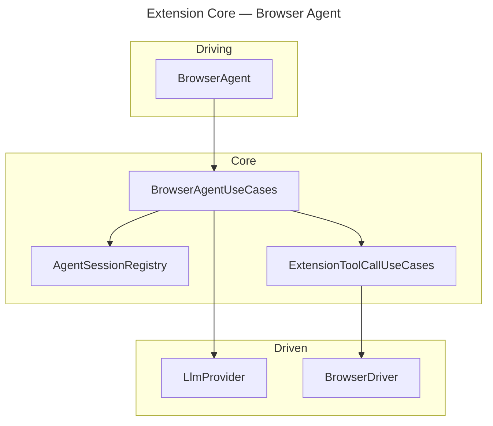

# L1 - Extension Architecture

All components grouped by runtime (the deployment "layers"); the channel sub-diagrams below detail
each cross-runtime link. `CoreExtension` internals are in
[Extension Core Architecture](#extension-core-architecture-level-0).

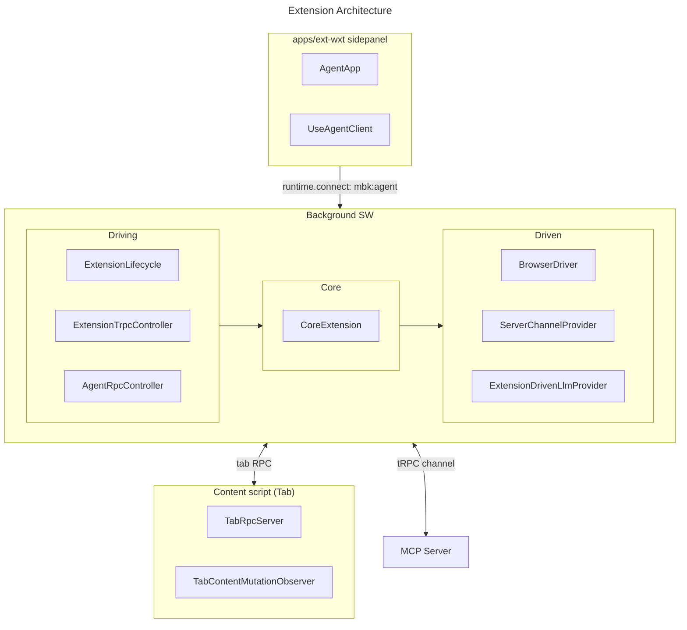

## L2 - Channel — Background ⇄ Tab

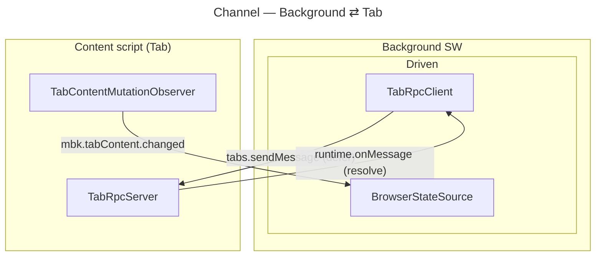

## L2 - Channel — Background ⇄ MCP Server

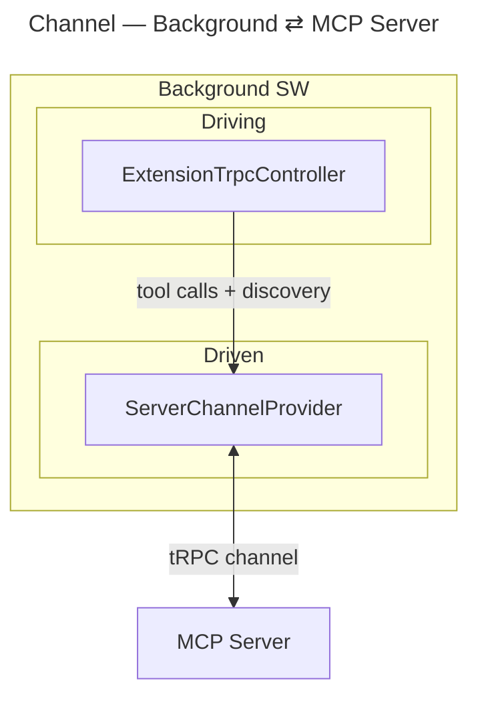

## L2 - Browser Agent Architecture

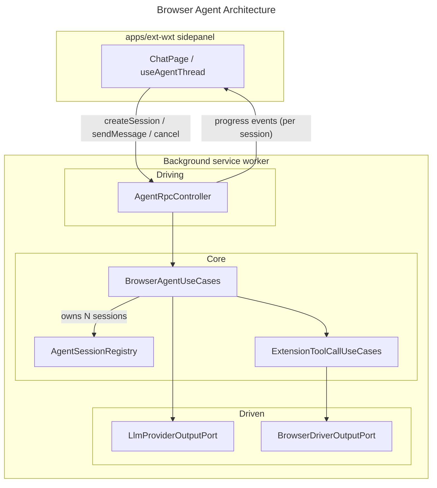

`AgentRpcController` is `@mcp-browser-kit/extension-driving-agent-rpc`. The
sidepanel and the background are separate documents, so it bridges them over a
single `browser.runtime` port named `mbk:agent`, multiplexed by frame key: RPC
`defer`/`resolve` frames for the imperative calls, pushed `agentEvent` frames for
the progress stream (`subscribe` takes a callback and cannot cross a port).

Two MV3 constraints shape it. Each connected UI gets its own transport and its
own agent subscription, torn down on disconnect, because the sidepanel is opened
and closed constantly. And because an idle service worker is evicted after ~30s
— taking the in-memory session registry with it — reconnection is lazy rather
than eager (reconnecting on disconnect would simply revive the worker) and
signals `onReconnect` so the UI re-hydrates from `listSessions`/`getHistory`
instead of trusting its cache.

`LlmProviderOutputPort` is realized by
`@mcp-browser-kit/extension-driven-llm-provider`. The port speaks in flat ids;
the adapter treats them as composite `"<providerId>:<modelId>"`, because model
ids are only unique within a provider — several expose a `gpt-4o`.

Provider and model metadata is **data, not code**. The adapter reads the
[models.dev](https://models.dev) registry — the same one OpenCode uses — so
adding a provider is an upstream registry entry rather than a release here.
That gives ~190 providers and ~5,800 tool-calling models. It is built on three
independent axes:

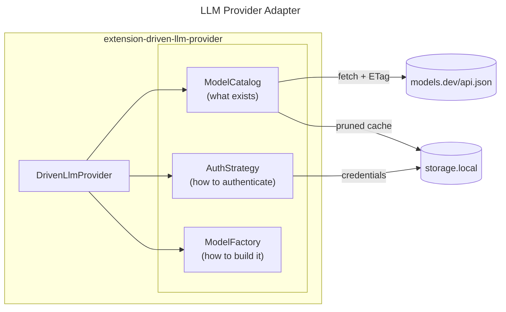

**Catalog.** The registry is ~4 MB, pruned on fetch to ~1.25 MB by dropping
non-tool-calling models (the agent is a tool loop, so a model without tool
calling would talk but never act) and unused fields. Cached in `storage.local`,
revalidated daily against models.dev's ETag. Failure is non-destructive: a bad
or empty response keeps the previous cache rather than replacing it with
nothing, because this is an external contract nobody here controls.

**Auth.** Keyed by provider id. Almost every provider is a plain bearer key.
GitHub Copilot is the exception — see below.

**Factory.** Keyed by the registry's `npm` field, defaulting to
`@ai-sdk/openai-compatible` over the registry's `api` URL. That default covers
152 of ~190 providers, which all carry a base URL, so they need no bundled code.
Five native SDKs (`anthropic`, `google`, `openai`, `openrouter`, `gateway`) are
`import()`ed lazily so they become separate chunks. `base-url-overrides.ts`
records URLs for the providers models.dev omits an `api` for because it lives
inside an SDK package.

MV3 forbids remotely hosted code, so OpenCode's approach of installing a
provider's npm package on demand is not available. Anything not covered by the
five bundled SDKs or the OpenAI-compatible default is reachable through the
custom-provider form, which also serves local servers (Ollama, LM Studio,
llama.cpp).

**GitHub Copilot** is an auth strategy, not a provider: models.dev lists it like
any other, so the models and transport come from the registry and only the
credential is unusual. A device flow yields a GitHub OAuth token which is used
directly as the bearer.

It previously presented an editor's OAuth client id, exchanged it at
`copilot_internal/v2/token`, and sent spoofed `editor-version` headers — an
undocumented path, contrary to Copilot's terms, which is why the provider was
gated off. GitHub now serves a versioned API (`X-GitHub-Api-Version`) that
accepts a token from a client registered by this project, so the impersonation
is gone along with the token-exchange step and its in-memory bearer cache.
`no-impersonation.test.ts` asserts the editor headers never return.

Two independent conditions decide whether Copilot is offered: the
`copilot-provider` feature flag (policy, now defaulting on) and
`hasCopilotClientId()` (build configuration). A build without a client id hides
Copilot regardless of the flag, rather than starting a sign-in GitHub would
reject. `moon run scripts:copilot-spike -- <CLIENT_ID>` validates a candidate id
end to end before it is committed; it confirmed that GitHub does not restrict
Copilot to allow-listed editor clients, which is the assumption the previous
implementation was built on.

Model listing asks Copilot what the account is entitled to rather than trusting
the registry, and memoizes the answer. The two lists do not merely differ in
size, they do not overlap: the registry advertises the current line-up
(`gpt-5.6-sol`, `claude-opus-5`) while this build's client is served a legacy set
(`gpt-4o`, `gpt-3.5-turbo`). Falling back to the registry therefore offers ids
that are certain to be rejected, so Copilot contributes nothing when its own
list is unavailable.

What an account is served depends on the **registered client**, not the
subscription. Confirmed by comparison: the same account runs `claude-opus-5`
through OpenCode's established client, while this project's newly registered app
is offered only `gpt-4o` and `gpt-3.5-turbo`. Installing the app on the account
changed nothing, and the app needs no permissions for what it does get.

Nothing in GitHub's documentation describes this, and no API exposes it. Every
other variable was eliminated by experiment or by reading OpenCode's client:

| Variable | Result |
| --- | --- |
| Impersonation headers | Not sent by OpenCode either |
| `X-GitHub-Api-Version` | Identical |
| Token type / exchange | Identical — a raw `ghu_` bearer |
| Reusing an editor's token | OpenCode does not |
| App installed on the account | Tested; no change |
| App visibility (private vs public) | Tested; no change |
| Requested permissions / scopes | Identical — `read:user` |
| Application type (OAuth App vs GitHub App) | Tested both, `gho_` and `ghu_`; no change |
| GitHub account / Copilot plan | Tested on the *same* account that reaches current models through OpenCode; no change |

With the account controlled — the same login, holding the same subscription,
reaching `claude-opus-5` through OpenCode and only `gpt-4o` through this client
— the client id is the sole remaining difference. An allow-list of editor and
partner clients is the only explanation consistent with that.

A newly registered client should expect the legacy set, and a model present in
models.dev is not evidence it can be reached. `scripts:copilot-spike` prints the
authenticated login for exactly this reason: a model list means nothing without
the account beside it, and comparing two runs without it invites blaming the
client for a difference in plan.

The narrowing rules — chat-only, picker-visible, tool-capable — are preferences
applied in order and never to an empty result. Applied as requirements they
eliminated every model an account had, because a legacy-only account has all of
them flagged `model_picker_enabled: false`.